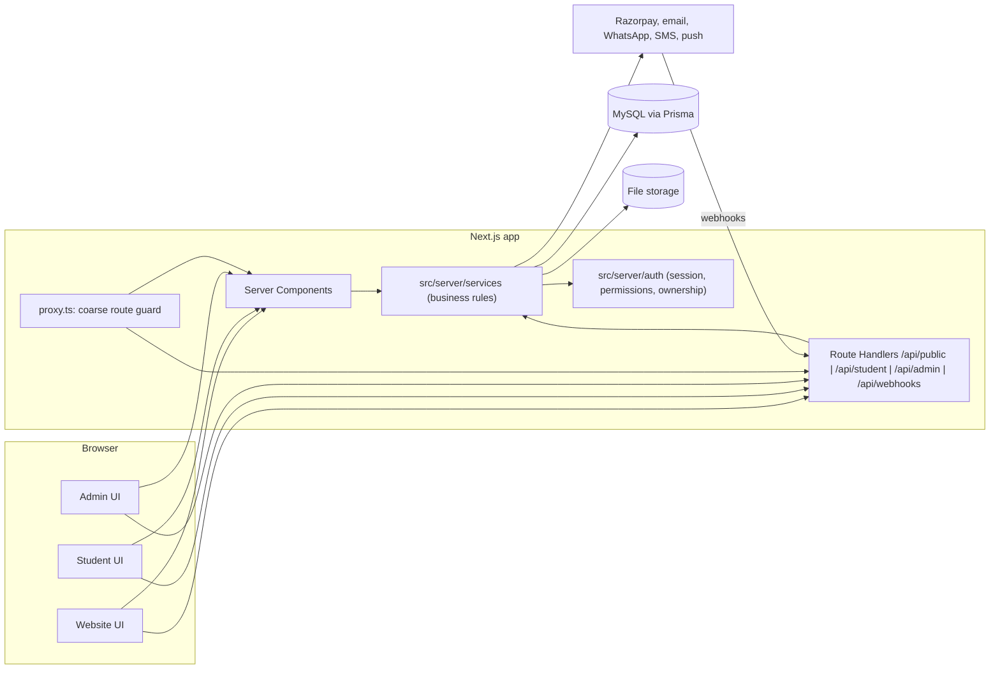
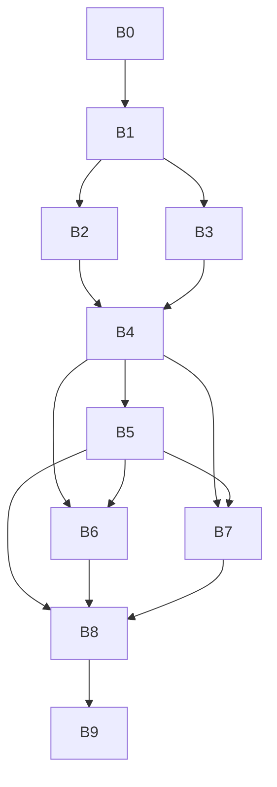

# IBMV LMS: Backend Master Plan

Entry point for building the real backend behind the three existing frontends
(Admin, Student, Public website) and wiring every page to it.

| Document | Purpose |
|---|---|
| **MASTER_PLAN.md** (this file) | Architecture, conventions, phase order, where to start, tracker |
| [FOUNDATION_PLAN.md](./FOUNDATION_PLAN.md) | Phase B0 (database, API infrastructure) and B1 (auth, roles, audit): do these first |
| [DATA_MODEL.md](./DATA_MODEL.md) | Prisma/MySQL model, grouped by domain and phase |
| [WEBSITE_BACKEND_PLAN.md](./WEBSITE_BACKEND_PLAN.md) | Public website: every page, phase by phase |
| [STUDENT_BACKEND_PLAN.md](./STUDENT_BACKEND_PLAN.md) | Student portal: every page, phase by phase |
| [ADMIN_BACKEND_PLAN.md](./ADMIN_BACKEND_PLAN.md) | Admin panel: every page, phase by phase |

Sources: [PLAN.md](../PLAN.md), [ADMIN_PANEL_SPEC.md](../ADMIN_PANEL_SPEC.md),
[STUDENT_PORTAL_SPEC.md](../STUDENT_PORTAL_SPEC.md),
[WEBSITE_PORTAL.md](../WEBSITE_PORTAL.md), [HIGH_LEVEL_DESIGN.md](../../docs/HIGH_LEVEL_DESIGN.md),
[PROJECT-STARTER.md](../PROJECT-STARTER.md), and the current frontend code in `src/`.

---

## 1. Current state and goal

**Today:** a single Next.js 16 App Router app. All three portals are clickable
frontends on synthetic data: `src/lib/admin/*` (list configs, demo data),
`src/lib/student/demo.ts`, `src/lib/website/*` (+ `official-courses.json`, 127
courses). No database, API, login, payment, or notification delivery exists.

**Goal:** replace every fixture with real persisted data, keeping the existing
UI. Admin list screens are driven by `ListConfig` (columns, filters, forms), so
the backend supplies the *rows and mutations* while the UI metadata stays.

**Chosen stack** (from `.github/copilot-instructions.md`; do not substitute):

| Concern | Choice |
|---|---|
| Server | Next.js Route Handlers + Server Components (same app, no separate API server) |
| Database | MySQL/MariaDB, `localhost:3306` for development |
| ORM | Prisma 7 + `@prisma/adapter-mariadb`, client generated to `src/generated/prisma` |
| Auth | Auth.js (NextAuth v5 beta), JWT sessions, `bcryptjs` hashing; Prisma adapter |
| Validation | Server-side schemas on every input (see decision D1) |
| Scripts | `tsx` for seed/maintenance scripts |
| Payments | Razorpay (sandbox first), Phase B5 |

Before writing route handlers, `proxy.ts`, or auth code, read the installed
guides in `node_modules/next/dist/docs/01-app/` (`03-api-reference/03-file-conventions/route.md`,
`proxy.md`, `02-guides/authentication.md`, `data-security.md`,
`environment-variables.md`). This Next.js version differs from older tutorials
(for example `params` is a `Promise`; `middleware` is now `proxy`).

---

## 2. Target architecture



Rules:

1. **Services own the business rules.** Server Components and Route Handlers
   both call `src/server/services/<domain>.ts`; they never contain queries or
   rules themselves. This lets pages read directly on the server without an
   HTTP round trip while keeping one implementation.
2. **Authorization in the service/handler, not only in `proxy.ts` or the UI.**
   Every protected read/write checks permission and ownership server-side.
3. **Browser code never imports Prisma** (`import "server-only"` in
   `src/server/**`).
4. **Responses are DTOs**, never raw Prisma rows (no password hashes, internal
   notes, or other users' data).

### Proposed source layout (created only as each phase needs it)

```text
prisma/
  schema.prisma
  migrations/
  seed.ts                      # synthetic dev data, ported from src/lib/**/demo*
prisma.config.ts
src/
  generated/prisma/            # generated client (gitignored or committed per team choice)
  auth.ts                      # Auth.js config
  proxy.ts                     # route guard for /admin and /student
  server/
    db.ts                      # Prisma singleton (MariaDB adapter, dev hot-reload safe)
    http/                      # handler wrapper, errors, pagination, rate limit, CSRF/origin check
    auth/                      # getSession, requireStaff, requireLearner, permissions, ownership
    audit/                     # writeAudit()
    storage/                   # file storage interface + local driver
    notify/                    # provider interfaces (email, WhatsApp, SMS, push) + dev driver
    services/                  # one module per domain (catalog, learners, batches, orders, ...)
    validators/                # input schemas per domain
    mappers/                   # DB row -> UI row/DTO (admin list rows)
  app/api/
    health/route.ts
    auth/[...nextauth]/route.ts
    public/...                 # unauthenticated, rate limited
    student/...                # learner session + ownership
    admin/...                  # staff session + permission
    webhooks/razorpay/route.ts
  lib/api/
    client.ts                  # typed fetch wrapper used by client components
    hooks.ts                   # useResourceList, useMutation helpers
```

---

## 3. API conventions (apply to all three portals)

| Topic | Convention |
|---|---|
| Namespaces | `/api/public/*` (no login), `/api/student/*` (learner), `/api/admin/*` (staff), `/api/webhooks/*` (provider signatures), `/api/auth/*` (Auth.js) |
| Success body | `{ "data": ..., "meta": { "page", "pageSize", "total" } }` (`meta` only for lists) |
| Error body | `{ "error": { "code": "VALIDATION_FAILED", "message": "...", "fields": { "email": "Invalid" } } }` |
| Status codes | 200/201 ok, 204 delete, 400 validation, 401 not signed in, 403 no permission, 404 not found *or not yours*, 409 conflict/duplicate, 422 business-rule failure, 429 rate limited, 5xx unexpected (generic message, details logged) |
| Resources | `GET /api/admin/<resource>` list, `POST` create, `GET/PATCH/DELETE /<resource>/<id>`, action endpoints `POST /<resource>/<id>/<action>` (`archive`, `duplicate`, `publish`) |
| List query | `?q=&tab=&filter.<key>=&from=&to=&sort=<key>&dir=asc\|desc&page=1&pageSize=25` (mirrors `ListConfig`: `searchKeys`, `tabs`, `filters`, `dateFilterKey`) |
| Export | `GET .../export?format=csv` with the same filters; exports **all matching rows**, permission-gated and audited |
| Dates | Stored UTC (`DateTime`); API returns ISO-8601; display timezone from the user's preference (default `Asia/Kolkata`) |
| Money | Integer minor units (`amountMinor`, paise) + `currency`; never floats |
| IDs | `cuid()` strings; human codes (registration no., order no., serial) are separate unique columns generated server-side |
| Deletes | Soft delete / archive for anything with history (`deletedAt`/`status`); hard delete only for unreferenced drafts |
| Idempotency | `Idempotency-Key` header on order/payment creation; unique constraints on provider payment ids |
| Concurrency | Optimistic `updatedAt` (or `version`) check on edits of shared records |
| Validation | Server validates everything; the UI validators (`editor-validation.ts`) stay for UX but are never trusted |
| Logging | Structured; never log passwords, tokens, payment payloads, or full learner contact data |
| Security | Auth + permission + ownership checks, rate limit on public/auth endpoints, same-origin check on mutations, secure headers, upload type/size validation, no secrets in `NEXT_PUBLIC_*` |

### 3.1 How the frontend calls the backend

Three patterns; each page in the portal plans states which one it uses.

| Pattern | Use for | How |
|---|---|---|
| **A. Server read** | Initial data for a page (catalog, dashboard, lists) | `page.tsx` (Server Component) calls a service directly and passes DTOs as props. No API hop, good for SEO and first paint. |
| **B. Client query** | Interactive lists, filters, pagination, polling | Client component calls `apiClient.get('/api/admin/<resource>', params)` through `useResourceList`. Loading, empty and **error states are distinct** (a failed request must not look like an empty list). |
| **C. Mutation** | Create/edit/delete/send/pay | Client component calls `apiClient.post/patch/delete`, shows Sonner toast, then refetches or updates the cache. Server returns field errors in the standard error shape, which the form maps to inline messages. |

**Admin list screens (the biggest saving).** `ListPage` already takes a
`ListConfig`. Migration per screen:

1. Keep `columns`, `filters`, `tabs`, `form`, `rowActions` in `list-configs.ts`.
   Delete only the fixture `rows`.
2. Add a resource definition in `src/server/admin/resources.ts`:
   `{ key: "learning/batches", model, permission, listQuery(), toRow(), create(), update(), archive() }`.
   `toRow()` returns the same flat `Row` shape the table already renders.
3. Replace `useState(config.rows)` in `ListPage` with `useResourceList(pageKey, query)`;
   replace local save/delete with `apiClient` mutations.
4. SSR the first page from the Server Component to avoid a spinner flash.

Screens with custom components (Dashboard, Sessions calendar, New Enrolment,
Community, Analytics, Promo Codes, Templates, Cheques, settings pages) get
dedicated endpoints; each is listed in the admin plan.

---

## 4. Phases (build order across all portals)

Aligned with [PLAN.md](../PLAN.md) phases 2-9. "B" = backend phase.

| Phase | Name | Website | Student | Admin | Exit gate |
|---|---|---|---|---|---|
| **B0** | Environment and API foundation | health | n/a | n/a | DB connected, migrations run, health check green, `lint`+`tsc`+`build` pass |
| **B1** | Identity, roles, audit | n/a | login, shell protection | login, shell protection, My Profile, Team, Sub-Organizations | Auth tests: no cross-learner access, role matrix enforced |
| **B2** | Catalog and public content | **all 144 routes from DB**, enquiry forms | course data in Home | Courses (new), Events, Categories, Module Library, Asset Library, Blogs, Banners, Testimonials, Leads, People/Books/Magazines/site content | Website renders from DB; admin edits appear publicly |
| **B3** | Learners, accounts, preferences | account handoff/links | Settings (Profile, Preferences), Help | Learners, Segments, Custom Fields, Learner Experience, Support inbox (new) | Learner can edit profile; admin sees it |
| **B4** | Learning operations | n/a | Home, My Learning, Course player, Announcements, Calendar | Batches, Sessions, Announcements, Session Recordings, New Enrolment, Dashboard (core) | Publish -> enrol -> schedule -> learn -> progress works end to end |
| **B5** | Commerce | native Enroll Now (if approved) | My Purchases, Memberships, Refer & Earn | Promo Codes, Misc Fees, International Selling, Abandoned Cart, Cheque Mgmt, Memberships (new), Orders and payments (new) | Sandbox payment success/fail/pending/duplicate/refund evidence |
| **B6** | Assessments and credentials | certificate verify page | Exams, Certificates | Question Bank, Assessments, Submissions, Feedback Forms, Certificates, Grading System | Exam and certificate scenarios pass for learner, instructor, admin |
| **B7** | Engagement and communications | n/a | Communities, notifications | Community, Discussions, Campaigns, Promo Templates, Workflows, System Notifications, Utility Wallet | Messages delivered via sandbox providers with consent/opt-out |
| **B8** | Analytics and remaining screens | n/a | n/a | Dashboard (full), 9 Analytics pages, Mentorships/eBooks/Test Series/Playlists (if approved) | Reports query real data; exports match filters |
| **B9** | Hardening and launch | SEO, caching | privacy review | audit view | Security, accessibility, 1,000+ VU load, backup/restore, migration rehearsal, UAT |

Phases can overlap only where dependencies allow: B2 and B3 can run in
parallel after B1; B6 and B7 can run in parallel after B4/B5.

### Dependency view



---

## 5. Where to start (first working session)

Do these in order; each is small and verifiable.

1. **Fix the connection string.** The supplied URL ends at `:3306/` with no
   database name. Create a database first (for example `ibmv_lms`) and use
   `mysql://<user>:<password>@localhost:3306/ibmv_lms`. Keep the real value
   only in `.env` (gitignored by `.env*`). For anything beyond local
   development create a dedicated MySQL user instead of `root`; local `root`
   is acceptable because `prisma migrate dev` needs rights to create a shadow
   database.
2. **Allow `.env.example` to be committed.** `.gitignore` currently ignores
   `.env*`; add `!.env.example`, then create `.env.example` with variable
   names and placeholders only.
3. **Install dependencies** (needs approval, see D1): `prisma`,
   `@prisma/client`, `@prisma/adapter-mariadb`, `dotenv`, `next-auth@beta`,
   `@auth/prisma-adapter`, `bcryptjs` (+ `@types/bcryptjs` if required),
   `tsx`, `server-only`, and the chosen validation library. Check advisories
   and engine compatibility first.
4. **Create `prisma.config.ts` and `prisma/schema.prisma`** with the MySQL
   datasource and the `prisma-client` generator output `src/generated/prisma`.
   Begin with the B1 identity models only.
5. **First migration** (`npm run db:migrate -- --name init_identity`) against
   the new empty database only. Never against a shared database.
6. **`src/server/db.ts`**, `GET /api/health` (checks DB with a trivial query),
   and the handler wrapper (errors, validation, pagination).
7. **Seed** an initial Super Admin from environment variables (one-time
   script, no default password committed).
8. **Auth.js credentials login**, `proxy.ts` guard, `requireStaff()` /
   `requireLearner()`, then protect `/admin` and `/student`.
9. **First vertical slice: Categories** (admin Settings > Categories to
   public catalog). It is small, touches every layer (model, service, resource
   registry, `ListPage` wiring, website read), and proves the pattern.
10. **Then Phase B2 in the order listed in the website and admin plans.**

Package scripts to add as each piece lands: `db:generate`, `db:migrate`,
`db:migrate:prod`, `db:push`, `db:seed` (only when `prisma/seed.ts` exists),
`db:studio`, `test`. Add `postinstall: prisma generate` only after generation
is verified.

---

## 6. Definition of done (every page)

A page is **Done** only when all are true:

- [ ] Data comes from the database; no fixture, `useDemoRecords`, or
      `localStorage` source remains for that page (demo badges/disclaimers
      removed or reworded).
- [ ] Every endpoint validates input, checks session + permission + ownership,
      and returns the standard error shape.
- [ ] Loading, empty, error, and success states are distinct and accessible.
- [ ] Consequential actions (delete, archive, publish, send, issue, refund,
      export) require confirmation and write an audit event.
- [ ] Sensitive fields (contact, payment, referral, community) are hidden from
      roles/learners that must not see them.
- [ ] Unit tests for service rules; integration/authorization tests for each
      endpoint (including "other learner's record returns 404").
- [ ] Seed data covers the page so reviewers can see it with synthetic data.
- [ ] `npm run lint`, `npx tsc --noEmit`, `npm run build`, and tests pass.
- [ ] Tracker row below updated; help article and README claims updated to match
      reality (the project's docs currently state "no backend", which must change
      as pages go live).

---

## 7. Decisions needed (block specific phases)

| ID | Decision | Blocks | Proposed default |
|---|---|---|---|
| D1 | Approve new dependencies and a validation library (the starter does not currently include one) | B0 | Add `zod` for server and form validation |
| D2 | Login method, verification (email/mobile OTP), recovery, staff MFA, account migration from the official site | B1, B3 | Email + password with email verification; MFA later; Google optional |
| D3 | Staff role/permission matrix (view/edit/publish/export/refund per role, branch scoping) | B1 | Start with the permission map in FOUNDATION_PLAN section 4; adjust after review |
| D4 | File/media storage and video provider (local disk for dev; S3-compatible or Cloudflare/Vimeo/YouTube for prod) | B2 assets, B4 player | Storage interface + local driver now; provider later |
| D5 | Email/WhatsApp/SMS/push providers and templates | B7 | Provider interface + console driver until accounts exist |
| D6 | Pricing, tax/GST, invoices, refunds, memberships, referral rules | B5 | Integer minor units, GST fields nullable until rules confirmed |
| D7 | Course completion, attendance, exam integrity, retake and certificate rules | B4, B6 | Configurable per course; defaults in each plan |
| D8 | Whether Mentorships, eBooks, Test Series, Playlists, Workflows, Discussions, Advanced Analytics are in scope | B7, B8 | Excluded until IBMV confirms |
| D9 | Native Enroll Now vs keep handoff to the official IBMV site | B5 website | Keep handoff until payments are accepted |
| D10 | Hosting, domains, backups, monitoring owner | B9 | Decide before staging |

**Gaps found while mapping pages to data** (no admin screen exists today):

- **Courses/catalog management.** The public site shows 127 courses but the
  admin nav has no Courses screen (Batches only reference a course name). Add
  *Products > Courses* in B2. **Done in B2.**
- **Memberships/plans management.** Students have Memberships and analytics
  has Membership Enrollments, but no admin plan screen. Add in B5.
- **Support requests inbox.** Student Help submits messages and the website has
  a contact path, but no admin screen receives them. Add under Engage or Users
  in B3 (or fold into Leads).
- **People, Books, Magazines, legal pages, contact settings.** Website content
  has no admin editor. Add *Website content* screens in B2 (or a Settings group).
  **Done in B2** (Website section: Site Settings, Books, People, Magazines, Videos, Legal Pages).

---

## 8. Progress tracker

Update the status cell as work lands: `Todo`, `In progress`, `Done`.

| Phase | Scope | Status | Completed | Evidence |
|---|---|---|---|---|
| B0 | Environment and API foundation | **Done** | 2026-11-25 | DB `ibmv_lms` migrated; `GET /api/health` returns `db: up`; lint, tsc, build and 35 tests pass |
| B1 | Identity, roles, audit | **Done** | 2026-11-25 | Staff/learner sign-in, role gates, audit; Team, My Profile, Sub-Organizations on the database; 52 unit/integration tests and 34 HTTP checks pass; deferrals listed in FOUNDATION_PLAN |
| B2 | Catalog and public content | **Done (core)** | 2026-11-25 | Public website reads the database (home, 6 catalogs, 127 course pages, books, magazines, people, contact, legal); admin Courses, Categories, Books, People, Magazines, Videos, Testimonials, Leads, Legal Pages and Site Settings on the database with role gates and audit; bulk-book form creates a lead; 63 unit/integration tests (11 new for B2) and 69 B2 HTTP checks pass; remaining B2 screens tracked as B2b |
| B2b | Remaining content screens: Blogs (+ public blog pages), Banners, Events, Asset Library with uploads (D4), editable About/Prabhupada copy | **Done** | 2026-11-27 | Asset Library, Banners, Events and Blogs are live. Editable About IBMV and Srila Prabhupada copy is stored in Website > Site Settings and rendered on the public pages. Course, book and people forms can select uploaded Asset Library images; usage tracking protects images used by those records. |
| B3 | Learners, accounts, preferences | **Done (core)** | 2026-11-25 | Learners can edit a validated profile and notification/consent preferences and write to support; staff manage learners (registration numbers, archive/restore, password-reset links, branch scoping) and answer requests in a Support Inbox; 73 unit/integration tests (10 new for B3) and 58 B3 HTTP checks pass; Segments, Custom Fields and Learner Experience tracked as B3b |
| B3b | Segments (rules), Custom Fields (definitions and values), Learner Experience (menu config read by the student shell) | **Done** | 2026-11-27 | Static and dynamic learner segments with memberships, database-backed custom field definitions and values, and persisted learner sidebar/profile visibility. |
| B4 | Learning operations | **Done (core)** | 2026-11-25 | Staff run Batches, Sessions (create, weekly repeat, reschedule, cancel with reason, holidays, attendance), Announcements and New Enrolment (single, bulk and CSV with dry runs) on the database with role/branch gates, clash and holiday rules and audit; Learners show Enrolled/Completed from their enrolments; learners see their own enrolments, classes (join link only from 15 minutes before the start) and notices with persisted read status on Home, My Learning, Calendar and Announcements; 87 unit/integration tests (33 unit, 54 server, 11 new for B4) and 86 B4 HTTP checks pass, browser-checked as admin and learner; course player, progress, recordings and the dashboard tracked as B4b |
| B4b | Course player (modules, lessons, progress, completion), Session Recordings, Dashboard (sessions and enrolments), Module Library it needs | **Done** | 2026-11-27 | Module Library, course/learner player, progress, recordings and dashboard are live. Per-batch ordered module choices now override course defaults and scope learner lessons/progress. Recording lists support authorized bulk deletion with audit events. |
| B5 | Commerce | **In progress** | 2026-11-27 | B5 data foundation is applied: orders, order items, payments, payment events, refunds, invoices, memberships, promos, referrals, cheques and abandoned carts. The learner My Purchases, Memberships and Referrals screens read the database; Membership plan CRUD is live. Native Razorpay checkout and the remaining promo/order/cheque admin workflows remain pending D6/D9/provider setup. |
| B6 | Assessments and credentials | **Done** | 2026-11-27 | Database-backed Question Banks, Assessments, Submissions, Feedback Forms, Grading, Certificates, learner exams and public certificate verification; timed attempts, autosave, submission, evaluation, issuance, revocation and private downloads are implemented |
| B7 | Engagement and communications | **In progress** | 2026-11-27 | B7 models and migration are live for communities, posts, reports, templates, campaigns, recipients, notification logs, system settings and wallets. Learner/community endpoints, database templates and wallet controls are implemented; real provider delivery and workflows remain gated by D5/D8. |
| B8 | Analytics and remaining screens | **Done (core)** | 2026-11-27 | Live analytics, audit, global search and notification shell remain. Added privacy-safe `UserActivity` tracking, live daily active users/time/views dashboard cards, membership enrollments, issued certificates, wallet recharges, assessment attempts and batch assessment reports. Campaign performance, bandwidth, scheduled tasks and provider-dependent reports remain waiting. Feedback, Notification Logs and Community Analytics stay explicit rather than synthetic. Conditional Mentorship/eBook/Test Series/Playlist/Advanced Analytics screens remain D8-gated. |
| B9 | Hardening and launch | Todo | | |

Per-page trackers live in the three portal plans.

---

## 9. Safety rules during development

- Use only the new empty `ibmv_lms` database. Never run migrations, seeds,
  resets, or destructive commands against any shared or existing database
  without explicit approval.
- Use synthetic data outside production. Do not copy real learner, payment, or
  credential data from the reference site.
- Payment, WhatsApp, SMS, and email stay on sandbox/console drivers until IBMV
  owns the provider accounts and approves templates.
- Never trust browser redirects as payment proof; only verified provider
  webhooks mark an order paid.
- Do not commit `.env`, tokens, or real credentials. Do not paste secrets into
  chat or documentation.
