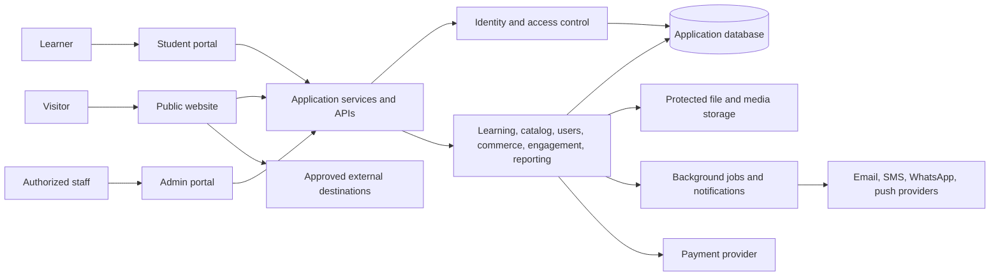
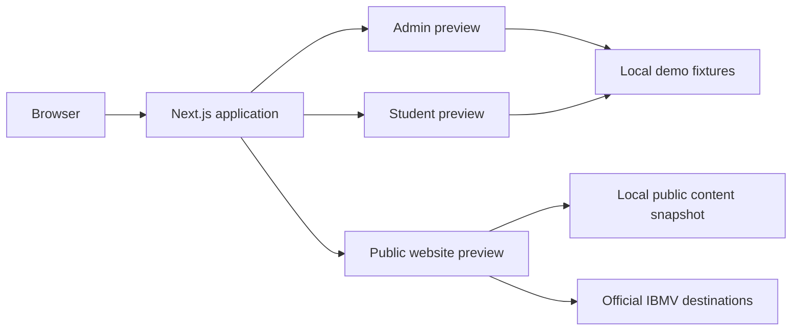
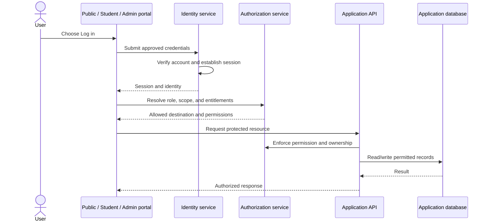

# IBMV Learning Management System

## High-Level Design

**Audience:** IBMV stakeholders, client reviewers, and delivery teams
**Document status:** Client review draft
**Scope:** Public website, learner portal, administrator portal, and the shared services needed to connect them

## 1. Executive Summary

The IBMV Learning Management System (LMS) is planned as one connected service with three user-facing portals:

- **Public website:** introduces IBMV, helps visitors find courses and publications, and directs them to approved enrollment and account services.

- **Student portal:** gives an authenticated learner access to their enrollments, learning activity, sessions, assessments, purchases, certificates, and preferences.
- **Admin portal:** gives authorized staff tools to publish learning products, manage learners and delivery, communicate with students, administer commerce, and review reports.

The portals share identity, permissions, learning data, and operational services in the production design. A typical lifecycle is: staff prepare and publish a course; a visitor discovers it and enrolls; the platform grants the resulting learner access; the student studies and participates; staff monitor delivery and outcomes.

**Important current-state note:** the workspace currently contains responsive frontend previews with synthetic data. It does not contain production login, a database, backend APIs, payment processing, or real notification delivery. The website's sign-up and log-in actions hand off to IBMV's official site. The `/student` and `/admin` routes are review demos and are not protected accounts. This document clearly labels production architecture and flows as proposed until IBMV approves the open decisions in section 11.

## 2. Goals and Boundaries

### Goals

- Present all current portal page groups and intended user journeys in one client-readable design.
- Explain how staff-managed course information should flow to public discovery and learner access.
- Establish a secure target for login, role-based access, learner privacy, payments, and content storage.
- Make the difference between implemented preview, proposed workflow, and unresolved business decision visible.

### Not implied by this document

- The current demo is not a live replacement for the official IBMV website or hosted course platform.
- Listed public course data is a snapshot, not an availability, fee, schedule, or eligibility guarantee.
- Proposed login, payment, exam, messaging, and certificate behaviors require IBMV approval and integration work.
- Hosting, database choice, identity provider, media provider, messaging providers, and final role permissions are not yet selected in this workspace.

## 3. Users and Portals

| User | Main portal | Primary responsibilities |
|---|---|---|
| Visitor / prospective learner | Public website | Discover IBMV, browse courses and publications, and follow approved contact or enrollment destinations. |
| Learner | Student portal | Access enrolled learning, sessions, notices, profile/preferences, and eligible learner services. |
| Instructor / trainer | Admin portal (permissions to confirm) | Support assigned courses, batches, sessions, assessments, and learner progress. |
| Support / academic operations | Admin portal (permissions to confirm) | Assist learners and coordinate course delivery. |
| Finance / marketing / content staff | Admin portal (permissions to confirm) | Perform scoped sales, communications, reporting, and publishing tasks. |
| Administrator / super-admin | Admin portal | Manage organization configuration and authorized staff operations. |

These staff personas are a target-role outline, not a confirmed permission matrix. IBMV must approve which roles can view, export, edit, publish, issue, refund, or delete each class of data.

## 4. Portal Page Inventory

This inventory describes the local review application. Route names are local preview routes, not production URL commitments. The page labels and proposed/decision states follow the application navigation and the specifications in `copilot/`.

### 4.1 Portal selector

- `/` - entry page linking to the Admin panel, Student portal, and Public website previews.

### 4.2 Admin portal

The admin preview has **9 navigation sections and 52 screens**, plus the searchable help center and per-page help articles. Admin pages share a sidebar, top bar, quick-create actions, command palette, and page-level help.

| Section | Screens |
|---|---|
| Home | Dashboard |
| Products | Events, Mentorships, eBooks, Test Series, Playlists |
| Learning | Batches, Sessions, Announcements, Feedback Forms, Module Library, Question Bank, Asset Library, Assessments, Submissions, Session Recordings, Certificates |
| Users | Learners, Team, Segments, New Enrolment |
| Engage | Community, Discussions |
| Marketing | Campaigns, Workflows, Blogs, Marketing Banners, Leads, Promotional Templates, Promo Codes, Testimonials |
| Sales | Abandoned Cart, Cheque Management |
| Analytics | Sales & Enrollment, Batch & Progress, Feedback & Rating, Marketing, Trainer, Notification Logs, Community Analytics, More, Advanced Analytics |
| Settings | My Profile, Sub-Organizations, System Notifications, Categories, Custom Fields, Grading System, Miscellaneous Fees, International Selling, Learner Experience, Utility Wallet |

Local admin routes are `/admin` for the dashboard and `/admin/{section}/{page}` for section pages. Help is at `/admin/help` and `/admin/help/{section}/{page}`.

The demo distinguishes screens designed from observed references from proposed designs and screens requiring an IBMV decision. Mentorships, eBooks, Test Series, Playlists, Discussions, and Workflows require validation; some were restricted, legacy, or marked Coming Soon in the reference. Leads, Testimonials, and several analytics screens are proposed surfaces. A clickable screen does not imply a connected or approved business workflow.

### 4.3 Student portal

The student preview has **13 core screens and 16 local URLs**, including three sample-course reading previews:

| Screen | Local route |
|---|---|
| Home | `/student` |
| My Learning | `/student/my-learning` |
| Sample learning preview | `/student/learning/{course}` |
| Announcements | `/student/announcements` |
| Calendar | `/student/calendar` |
| Certificates | `/student/certificates` |
| Communities | `/student/communities` |
| Exams | `/student/exams` |
| Help | `/student/help` |
| Memberships | `/student/memberships` |
| My Purchases | `/student/my-purchases` |
| Refer & Earn | `/student/refer-and-earn` |
| Settings: Profile | `/student/settings/profile` |
| Settings: Preferences | `/student/settings/preferences` |

Current student records and edits are fictional and temporary. The sample reader is not a verified course player; it does not save notes, record completion, or grant credentials. Exams, payment, membership management, referral redemption, support submission, and real certificate issuance are not connected.

### 4.4 Public website

The local website preview has **144 routes**: the homepage, 16 secondary pages, and 127 course detail pages. It supports course discovery against a local snapshot.

| Page group | Local route(s) |
|---|---|
| Home | `/website` |
| Course collections | `/website/bhagavata-mahavidyalaya`, `/website/self-study`, `/website/ancient-wisdom`, `/website/kids-parents`, `/website/level-wise`, `/website/live-classes` |
| Course details | `/website/course/{slug}` for the 127 imported public listings |
| Publications | `/website/books`, `/website/e-magazines` |
| Institution and people | `/website/iskcon-bhagavata-mahavidyalaya`, `/website/srila-prabhupada`, `/website/our-advisory-board-members`, `/website/our-team` |
| Contact and account handoff | `/website/contact`, `/website/account` |
| Preview notices | `/website/privacy`, `/website/terms` |

Catalogs provide search, supported filters, and no-results states. The course details link to official IBMV pages for current details and enrollment. The books enquiry is an unsent local draft; the magazine archive and some institutional information await approved content. Preview privacy and terms pages are not approved legal policies.

## 5. How the LMS Works

### 5.1 Target end-to-end learning journey

1. **Prepare:** an authorized administrator creates or configures a product/course, learning modules and assets, an offering or batch, its schedule, and learner-facing content.
2. **Publish:** approved information becomes visible in the public catalog. Publication and visibility rules determine what visitors can discover.
3. **Discover:** a visitor browses collections, filters offerings, and reviews the course details, eligibility, schedule, and price.
4. **Enroll:** the visitor follows the approved enrollment and checkout flow. The server validates eligibility and price; any payment result is confirmed by the payment provider before an order is marked paid.
5. **Grant access:** after confirmed enrollment or another approved entitlement, the platform links the learner to the offering and its permitted content.
6. **Learn:** the student views authorized lessons, sessions, announcements, and assessments. The server records progress only under the agreed completion rules.
7. **Operate and support:** staff manage sessions, attendance, communications, submissions, and learner support within role permissions.
8. **Complete and report:** approved assessment and completion rules determine results and certificate eligibility. Admin reports use persisted records and role-scoped access.

The current preview implements only parts of discovery and interface demonstration. Steps involving live records, identity, enrollment, payment, delivery, progress, and credentials are production scope, not active demo behavior.

### 5.2 Target architecture overview

This diagram is the proposed logical design, not a claim that those services are configured. The technology choices, hosting boundaries, API style, database, and providers require architecture decisions before production build.

### 5.3 Current preview architecture

The workspace is a single Next.js App Router application using React, TypeScript, Tailwind CSS, and shared UI components. Route-level modules render the three portals. Local content fixtures provide synthetic admin/student data and the imported public catalog snapshot. Most interactions are page-local; a limited set of admin drafts explicitly use browser storage. There is no API or database connection, no production identity layer, and no authoritative shared state.

## 6. Login and Access Design

### Current login behavior

- There is no local login, sign-up, password recovery, or sign-out service in this project.
- Public website Sign up / Log in buttons and the learner-access page hand off to the official IBMV website.
- `/student` is a public demonstration and its **Exit demo** control is not a real sign-out.
- The local admin screens are also a review interface, not a protected staff account.
- Do not enter real personal, learner, financial, or confidential data in either demo portal.

### Proposed production login journey

1. The user selects **Log in** from an approved IBMV entry point.
2. The identity service validates the chosen sign-in method. Email/mobile verification, password recovery, and any staff MFA requirements are to be confirmed with IBMV.
3. A secure session is established. The system resolves the user's account, active status, role, organization/branch scope, and any learner entitlements.
4. Learners are directed to their student home; authorized staff are directed to the admin area permitted by their role. Unauthenticated users return to sign-in; authenticated users without a required permission receive an access-denied state.
5. Every protected read and write checks authorization on the server. Hiding a link or protecting only the page UI is not sufficient.
6. Sign-out invalidates the session. Expiry, recovery, account lockout, device policy, and session revocation rules are defined during discovery.

Identity method, account migration, parent/guardian support, staff MFA, and exact role permissions are open decisions. The login design must not assume that the current official-site account can be reused until IBMV confirms identity integration and migration.

## 7. Main Production Modules and Information Flow

| Module | Responsibility | Main connected data |
|---|---|---|
| Public content and catalog | Publish institutional pages, course/product listings, books, and approved media metadata. | Courses, categories, modules, assets, people/content, visibility state |
| Identity and organization | Authenticate users and enforce role, branch, and ownership boundaries. | Users, roles, permissions, organizations, sessions, audit events |
| Learning operations | Manage offerings, batches, sessions, announcements, assets, assessments, and submissions. | Courses, batches, lessons, sessions, attendance, questions, submissions |
| Enrollment and commerce | Validate registration, enrollment eligibility, orders, payment state, coupons, and entitlements. | Learners, offerings, orders, payment references, memberships, entitlements |
| Student experience | Present the learner's permitted study and account information. | Enrollment, progress, calendar, notices, certificates, preferences |
| Engagement and messaging | Manage communities, campaigns, templates, notifications, and provider delivery status. | Consent/preferences, messages, templates, delivery jobs, audit records |
| Reporting and administration | Provide scoped operational/financial reports and organization settings. | Authorized source records, configuration, filtered report outputs |

Suggested core records include users and roles; organizations/branches; courses, modules, lessons and assets; batches, sessions and enrollments; progress and attendance; products, orders, payments and entitlements; assessments, questions, submissions and certificates; communities, announcements, campaigns and notifications; and settings/audit events. This is a conceptual model only; the normalized schema and retention rules remain to be designed.

## 8. Security, Privacy, and Operational Controls

Production implementation should include:

- Server-side authentication and role/permission checks for every protected operation, including ownership checks for learner-specific records.
- Least-privilege roles and branch scoping; audit logging for consequential administrative, financial, assessment, and certificate actions.
- Secure session handling, input validation, output encoding, CSRF/session protections as appropriate, rate limiting, secure headers, and secret management.
- Private media delivery through access-controlled storage and short-lived links where appropriate; uploaded files require type/size validation and malware/security policy.
- Payment verification on the server, idempotent provider webhook handling, duplicate-payment protection, reconciliation, and no trust in browser redirects as payment proof.
- Consent and opt-out handling for communications; provider credentials and delivery errors managed outside the browser.
- Data minimization, approved retention/deletion/export rules, privacy/legal review, and synthetic test data outside production.
- Backups, restore rehearsal, monitoring, error tracking, health checks, alerts, and documented operational ownership.

The preview currently has no production security boundary. Do not expose demo routes as authenticated production services or connect real records until this section is implemented and tested.

## 9. External Services and Integration Boundaries

The target may integrate payment, email, WhatsApp Business, SMS, push, video/media, live-class, analytics, and social/app destinations. IBMV must own or approve the provider accounts, contracts, data sharing, templates, and operational responsibilities. Razorpay is named in the project plan as the proposed payment integration, but it is not connected in the current application. No provider is configured by this HLD.

Public preview links intentionally hand visitors to official course, account, book, contact, donation, or social destinations where configured. A handoff is not an enrollment, payment, or message confirmation. Production integrations need explicit success, failure, pending, cancellation, and retry states.

## 10. Quality Attributes and Release Approach

- **Responsive and accessible:** support approved mobile, tablet, and desktop breakpoints; keyboard navigation, visible focus, semantic labels, reduced motion, contrast, and assistive-technology review.
- **Performance and scale:** the project plan proposes a 1,000+ concurrent virtual-user validation on agreed production-equivalent infrastructure. This is a test target, not a capacity guarantee and not a promise of 1,000 simultaneous video streams.
- **Reliability:** define uptime, backup retention, recovery time/objectives, provider outage behavior, and incident ownership before launch.
- **SEO and public content:** production public pages require approved metadata, canonical URLs, redirect strategy, sitemap, and search-engine review. The current public preview is marked no-index.
- **Quality gates:** lint, type-check, unit/component/integration tests, authorization tests, end-to-end critical journeys, accessibility review, security testing, load test, and backup/restore evidence.
- **Delivery:** stage work with IBMV reviews and acceptance gates; do not activate financial, identity, or messaging workflows before their provider and business rules are approved.

Recommended end-to-end acceptance journeys include visitor-to-enrollment, staff course setup-to-publication, payment confirmation-to-entitlement, learner lesson access-to-progress, assessment-to-result, eligibility-to-certificate, and staff role/branch access checks.

## 11. Decisions Required from IBMV

1. Confirm this scope and the authoritative commercial proposal / acceptance owner.
2. Approve sign-up and login methods, verification and recovery, account migration, parent/guardian handling, staff MFA, and session policy.
3. Approve staff roles, branch scopes, data visibility, exports, and high-impact action permissions.
4. Select hosting, domains, database, API architecture, identity provider, monitoring, backup ownership, and support responsibilities.
5. Confirm enrollment eligibility, course access periods, prices/tax/invoices, refunds, memberships, promo-code and referral rules, and payment provider ownership.
6. Confirm lesson formats, progress completion rules, live-class provider, attendance, recording access, assessments/exam integrity, grading, and certificate criteria.
7. Approve community moderation, notification consent/opt-out, message providers/templates, support workflow, and data retention.
8. Approve public content ownership, course availability source, staff biographies, magazine archive, contact/legal copy, privacy policy, terms, and external destinations.
9. Confirm migration sources, cleanup responsibility, historical progress/payment/certificate handling, reconciliation, and rollback criteria.
10. Agree browser/device support, accessibility standard, service levels, recovery objectives, and production-equivalent load-test thresholds.

## 12. Delivery Outline

The existing phase plan provides the recommended delivery sequence:

1. **Discovery and scope:** requirements traceability, role matrix, business rules, migration and integration decisions.
2. **Design and foundation:** approved design system, environments, CI, identity/access, API/data contracts, security and operations.
3. **Public website:** approved content, catalog, course details, account/enrollment handoffs, SEO and content publishing.
4. **Student identity and portal:** secure account, settings, help, student home and protected learner data.
5. **Learning operations:** courses, modules/assets, batches, sessions, enrollment, course access, progress, announcements.
6. **Commerce:** payments, orders, memberships, entitlements, coupons, referrals, finance workflows.
7. **Assessments and credentials:** question banks, exams, submissions, grading, certificates and verification.
8. **Engagement and administration:** communities, messaging, marketing, analytics and organization settings.
9. **Quality and launch:** security/accessibility/load validation, migration rehearsal, UAT, training, cutover and handover.

Quality, security, and accessibility work continues across phases. Production launch is gated on IBMV decisions, data readiness, authorization tests, provider sandbox evidence, and acceptance of the critical journeys.

## 13. Reference Documents

- [Project implementation plan](../copilot/PLAN.md)
- [Admin panel specification](../copilot/ADMIN_PANEL_SPEC.md)
- [Student portal specification](../copilot/STUDENT_PORTAL_SPEC.md)
- [Public website specification](../copilot/WEBSITE_PORTAL.md)
- [Project starter and engineering conventions](../copilot/PROJECT-STARTER.md)
- [Customer proposal](CUSTOMER_PROPOSAL.md)
- [Repository status and local preview boundaries](../README.md)

The `copilot/` documents are observation-based requirements references. They describe visible screens and proposed behavior, not the source platform's internal APIs or guarantees. Restricted, legacy, loading, empty, and Coming Soon states must be confirmed with IBMV before production requirements are finalized.
